<p align="center"></p>

<p align="center">Hiện công thức LaTeX trong chat Kilo Desktop (Windows), dùng tạm tới khi Kilo sửa <a href="https://github.com/Kilo-Org/kilo-desktop/issues/70">#70</a>.</p>

<p align="center"></p>

**Cài**: mở PowerShell rồi dán lệnh này. Mỗi lần Kilo cập nhật thì chạy lại.

```powershell
irm https://raw.githubusercontent.com/QuangquyNguyenvo/kilo-latex-patch/main/install.ps1 | iex
```

**Gỡ**

```powershell
& ([scriptblock]::Create((irm https://raw.githubusercontent.com/QuangquyNguyenvo/kilo-latex-patch/main/install.ps1))) restore
```

<p align="center"></p>

<details><summary>Cách hoạt động</summary>

Tool chèn `remark-math` và `rehype-katex` vào bộ hiển thị markdown của Kilo, hỗ trợ `$$…$$`, `\[…\]`, `\(…\)` và `$…$`. Nó cũng cập nhật mã kiểm tra toàn vẹn trong `kilo-desktop.exe`, nên chữ ký số của file exe không còn hợp lệ. App vẫn chạy bình thường khi Smart App Control tắt. Lệnh gỡ trả mọi file về giống hệt bản gốc. Cần Node.js 18 trở lên; nếu máy chưa có, script sẽ hỏi rồi cài giúp.

</details>

<p align="center"></p>
